<p align="center">
  
</p>

<h1 align="center">Sensveil</h1>

<p align="center">免费的 macOS 窗口防窥工具，让暂时不用的应用窗口保持模糊。</p>

<p align="center">
  <a href="LICENSE">MIT License</a> ·
  <a href="#快速开始">快速开始</a> ·
  <a href="#当前状态与支持范围">支持范围</a> ·
  <a href="CONTRIBUTING.md">参与贡献</a>
</p>

Sensveil 在指定应用失去焦点时，为其窗口显示模糊保护层；切回该应用后，移除保护层，恢复清晰使用。它适合在办公、演示或共享工作空间中，减少后台窗口内容被随意看到的机会。

项目采用原生 Swift 6、SwiftUI 与 AppKit 实现，核心保护和配置在本机离线运行。全面免费，不限制配置应用数量，不设付费版、试用、购买、激活或设备绑定。

> **当前是已开源的开发版本。** 仓库已有可构建的产品应用与测试，尚无正式可下载版本，公开发行、Developer ID 签名和公证流程仍待建立。兼容性与隐私强度验收尚未完成；能构建或测试通过，不代表所在系统可以可靠保护窗口。

## 功能

| 能力 | 当前实现 |
| --- | --- |
| 按应用保护 | 搜索本机应用名称或应用标识，也可浏览选择应用；支持单独启用、停用和移除 |
| 失焦模糊 | 在符合当前验证条件的窗口上显示模糊保护层，应用重新聚焦后移除 |
| 模糊效果 | 标准、增强、最强三档；可开关居中的“Sensveil 守护中”提示 |
| 保护时段 | 全天保护，或按每周日期设置时段；可单独设置中国大陆节假日与调休上班时段 |
| 即时状态 | 显示前台使用中、已保护、部分窗口无法保护、无法保护、非保护时段等状态 |
| 全局暂停 | 菜单栏与管理窗口标题栏提供暂停、恢复保护操作 |
| 原生管理界面 | 防窥应用、防窥设置、权限、通用和关于；效果与时段共用保存、放弃操作 |
| 中英界面 | 跟随系统、简体中文、English；偏好持久化，切换立即生效 |

节假日日历随应用离线内置，目前仅包含 **2026 年中国大陆官方安排**。尚无对应年度数据时，回退每周规则并显示提示，不沿用旧年度安排；数据随应用版本更新。时段按本机时区判断。

登录启动尚未实现。保护过渡选项当前隐藏，产品使用固定 200ms 过渡；这不代表动画中间帧的隐私效果已经通过验收。

## 当前状态与支持范围

首期仅面向 **macOS**，Windows 暂缓。Swift 包的最低构建目标是 macOS 14，但 macOS 14 与 Intel 的实际运行尚未完成验证。

当前保护成功状态受严格的环境与窗口检查限制：

- 已接受的材料环境限定为 macOS `27.0.1`（构建号 `26A434`）、arm64，以及正常透明度、对比度设置。这是当前代码中的本机验收条件，不是通用系统支持声明。
- 多显示器下按窗口检查归属，允许正常的 1× / 2× 比例；外扩后的保护范围必须完整且唯一地位于一台显示器内。跨屏窗口、覆盖超出屏幕边缘等情况仍会拒绝保护。
- 普通窗口之外的 sheet、全屏、Spaces、Stage Manager，以及其他系统版本和显示模式，仍有待验证。不同显示器上的实际模糊可读性也未完成全面验收。
- 缺少当前有效证据、窗口身份或层级不明、权限失效、环境不受支持时，应用显示“无法保护”或“部分窗口无法保护”。**不会静默改用不透明遮罩，也不会把保护层已创建当成保护成功。**

已有核心规则测试、有限合成窗口检查与本机人工观察。请分别查看[材料与守护文案接入记录](docs/engineering/BLUR_LABEL_INTEGRATION.md)、[多显示器验证](docs/engineering/MULTI_DISPLAY_VALIDATION.md)和[保护过渡验证](docs/engineering/PROTECTION_TRANSITION_VALIDATION.md)，了解证据与未测项。早期 [PoC 结果](docs/engineering/POC_RESULTS.md)保留为历史记录，不能替代后续产品验收。

## 快速开始

### 环境要求

- macOS 开发环境，可用的 Xcode、Swift 6 工具链与 macOS SDK。
- Git 和对安装目标目录的写入权限。
- Swift 包没有第三方依赖；系统能力仍受上述验证范围限制。

### 从源码构建

```sh
git clone https://github.com/NieAnSHOW/Sensveil.git
cd Sensveil

# 运行核心与产品规则测试
swift test --package-path experiments/macos-blur-poc

# 构建、评估、安装并启动产品应用
bash experiments/macos-blur-poc/scripts/build-apps.sh
```

构建脚本生成 `experiments/macos-blur-poc/.build/apps/` 下的三个应用：

| 应用 | 用途 |
| --- | --- |
| `Sensveil.app` | 菜单栏产品应用，默认安装并启动于 `/Applications/Sensveil.app` |
| `SensveilPoC.app` | 手动运行的诊断实验，不自动安装 |
| `SensveilFixture.app` | 仅含虚构数据的测试窗口，不自动安装 |

只验证构建、不安装和启动时：

```sh
SENSVEIL_INSTALL=0 bash experiments/macos-blur-poc/scripts/build-apps.sh
```

默认采用 ad-hoc 签名，重新构建后可能需要重新授予辅助功能权限。脚本验证签名完整性，并在安装前后执行 macOS 执行评估；被系统拒绝时会停止。它不自动选择本机证书，不使用 `sudo`，不关闭系统安全检查、不清除隔离标记，也不重置权限。证书签名必须先获得授权，再显式指定 `SENSVEIL_SIGNING_IDENTITY`。安装回滚、自定义路径及签名细节见[开发指南](docs/engineering/DEVELOPMENT.md)。

### 首次使用

1. 启动 Sensveil，从菜单栏打开管理窗口。
2. 进入“权限”，主动请求辅助功能权限，并按系统提示授权；必要时刷新权限状态。
3. 在“防窥应用”中添加目标应用，确认单应用保护已开启。
4. 在“防窥设置”调整模糊档位、守护提示和保护时段，点击保存。
5. 切换到其他应用，观察目标窗口与应用状态。只有显示“已保护”才代表当前运行时检查已通过；出现“无法保护”时，请按提示检查权限、窗口与环境。

可从标题栏或菜单栏随时暂停、恢复保护。关闭管理窗口后，应用继续在菜单栏运行；完全退出请使用菜单中的“退出 Sensveil”或 `⌘Q`。

## 权限与隐私

| 权限 | 用途 | 是否为日常保护所需 |
| --- | --- | --- |
| 辅助功能 | 识别目标应用窗口并跟随窗口位置 | 是，由用户在管理界面主动请求 |
| 屏幕录制 | 独立实验与可选诊断；相关实验仅使用明确选择的合成 fixture | 否，日常窗口保护不依赖此权限 |

核心保护与配置不依赖网络或商业许可服务，不发送激活、试用或设备绑定请求。关于页的项目、作者链接仅在用户点击时打开系统浏览器。

Sensveil 提供本地窗口防窥体验，无法替代操作系统访问控制或恶意软件防护，也不能保证阻止所有截图、摄像和外部采集方式。请勿在公开 Issue、PR、日志或截图中包含真实私密屏幕内容、设备标识、密钥或开发者证书。漏洞报告方式见[安全策略](SECURITY.md)。

## 开发

产品目前与 PoC 共用独立 SwiftPM 工程，因此产品源码仍位于 `experiments/` 目录内：

```text
.
├── experiments/macos-blur-poc/
│   ├── Package.swift
│   ├── Resources/                 # 产品 Logo 源图
│   ├── Sources/
│   │   ├── Sensveil/              # 产品界面、配置、时段与保护运行时
│   │   ├── SensveilApp/           # 产品应用入口
│   │   ├── PoCCore/               # 窗口匹配、坐标与保护意图规则
│   │   ├── ContourProbeCore/      # 轮廓实验共用逻辑
│   │   ├── SensveilPoC/           # 诊断实验
│   │   └── SensveilFixture/       # 合成测试窗口
│   ├── Tests/                    # XCTest 测试
│   └── scripts/                  # 应用封装、图标生成与安装
├── docs/
│   ├── product/                  # 产品需求
│   ├── architecture/             # 技术选型、ADR 与使用政策
│   ├── engineering/              # 开发说明、验证证据与未测项
│   └── decisions/                # 待决策事项
├── CONTRIBUTING.md
├── SECURITY.md
└── LICENSE
```

测试覆盖窗口匹配、坐标与生命周期、配置、保护时段、协调器、状态和菜单动作等规则。自动测试不能证明屏幕上的模糊内容不可读；涉及系统能力的变更仍需真机验证，并记录系统版本、显示环境、窗口类型、权限状态与未测项。

```sh
# 完整 Swift 测试
swift test --package-path experiments/macos-blur-poc

# 文档及补丁格式检查
git diff --check
```

实验命令与安全约束见 [macOS 实验 README](experiments/macos-blur-poc/README.md)。请只使用 fixture 的虚构数据开展公开验证。

## 文档导航

| 文档 | 内容 |
| --- | --- |
| [产品需求](docs/product/PRD.md) | 目标、用户行为与产品边界 |
| [技术选型](docs/architecture/TECH_SELECTION.md) · [原生 macOS ADR](docs/architecture/ADR-001-native-macos.md) | 技术路线与决策依据 |
| [免费使用与离线政策](docs/architecture/LICENSE_PROTOCOL.md) | 免费范围、离线要求与历史政策替代关系 |
| [开发指南](docs/engineering/DEVELOPMENT.md) | 构建、签名、安装与开发约定 |
| [可行性验证](docs/engineering/FEASIBILITY_SPIKE.md) · [MVP 验证](docs/engineering/MVP_VALIDATION.md) | 验证计划、证据与未完成项目 |
| [多显示器验证](docs/engineering/MULTI_DISPLAY_VALIDATION.md) | 显示器归属、比例与覆盖限制 |
| [中英国际化与布局验证](docs/engineering/I18N_LAYOUT_VALIDATION.md) · [固定窗口验证](docs/engineering/FIXED_WINDOW_VALIDATION.md) | 界面行为及验证边界 |
| [待决策问题](docs/decisions/OPEN_QUESTIONS.md) | 平台、兼容性与发布待办 |

历史计划和报告可能保留早期额度、试用与激活条目；这些政策已于 2026-10-14 废弃，不再参与当前保护判定。

## 参与贡献

欢迎提交问题、文档改进、可复现的兼容性报告和代码 PR。开始前请阅读[贡献指南](CONTRIBUTING.md)；涉及系统能力、权限、用户行为或使用政策时，先更新对应产品文档或 ADR。报告问题请说明应用版本、系统版本、复现步骤、预期与实际结果，并使用虚构内容替代隐私数据。

- [提交 Issue](https://github.com/NieAnSHOW/Sensveil/issues)
- [查看 Pull Requests](https://github.com/NieAnSHOW/Sensveil/pulls)
- [作者 GitHub](https://github.com/NieAnSHOW)

## 开源协议

Sensveil 使用 [MIT License](LICENSE)。允许在保留版权声明和许可声明的前提下使用、复制、修改、分发及商业使用；软件按原样提供，不附带担保。完整条款以 `LICENSE` 为准。
