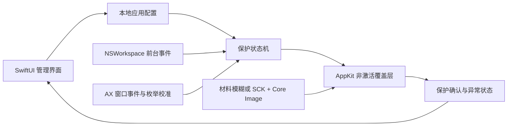

# Sensveil 技术选型

日期：2026-10-14 · 状态：原生 macOS 产品实现与免费使用基线；支持矩阵仍需验证

## 1. 决策摘要

一期采用 **Swift 6 + SwiftUI + AppKit**。SwiftUI 承载分栏管理界面，AppKit 管理菜单栏、非激活覆盖窗口和系统生命周期；ApplicationServices Accessibility 跟踪外部窗口，NSWorkspace 观察应用级焦点。

模糊渲染有两个候选：先验证无需主动采集像素的 `NSVisualEffectView.behindWindow`；若隐私强度不满足，再验证 `ScreenCaptureKit + Core Image` 按窗口捕获并模糊。**用户不接受不透明遮罩替代模糊。** 两条路线都不能可靠满足时，明确无法保护，回到产品评审。

macOS 14、Apple Silicon 与 Intel 为建议支持基线，尚无真机证据。Windows 一期不实现；未来可复用配置语义与测试用例，窗口引擎按平台独立实现。

## 2. 框架比较

| 维度 | SwiftUI + AppKit | Tauri 2 | Electron |
| --- | --- | --- | --- |
| 外部窗口/AX/焦点 | 系统 API 直接使用 | 需 Rust FFI 或原生插件 | 需 Node 原生模块或 Objective-C 桥 |
| 真正跨应用模糊 | AppKit/SCK 原生渲染 | WebView 内 CSS blur 无法替代外部窗口模糊 | 网页 CSS blur 同样不能解决外部窗口模糊 |
| 覆盖层/Spaces/输入 | 对 NSPanel/NSWindow 有直接控制 | 特殊行为需原生适配 | BrowserWindow 能穿透与工作区控制，核心仍需原生 |
| 常驻体积与资源 | 最符合轻量菜单栏工具 | WebView + Rust，有额外桥接成本 | Chromium 常驻成本较高 |
| Windows 后续 | UI 与窗口引擎分别开发 | UI 可复用，引擎仍分平台 | UI 可复用，引擎仍分平台 |
| 当前结论 | 推荐 | 若后续 Web UI 复用收益明确，可重评 | 一期无 Chromium 需求，不选 |

不为了尚未排期的 Windows 提前增加 Rust/Node 桥接，也不把 CSS 模糊当作本产品的核心技术能力。

## 3. 组件与数据流

| 模块 | 职责 | 不承担的职责 |
| --- | --- | --- |
| AppCatalog/Configuration | bundle ID、名称图标、选择与持久化 | 采集屏幕 |
| FocusMonitor | 发布当前前台 PID/归属与变化事件 | 操作覆盖层 |
| WindowTracker | 窗口归属、几何、可见性和生命周期 | UI |
| ProtectionPolicy | 结合配置、焦点、时段、权限计算期望状态 | 直接调用窗口 API |
| BlurRenderer/OverlayCoordinator | 真实模糊、覆盖层位置/层级/撤销和结果确认 | 修改用户配置 |
| PermissionCoordinator | 检测所需权限、引导与恢复 | 自动承诺权限已授予 |

以上是职责边界示意，不保证与当前类名一一对应；已有 SwiftPM 实现位于 `experiments/macos-blur-poc/`，以实现和验证记录为准。UI/覆盖操作在主线程执行，窗口跟踪、捕获回调与配置更新采用明确并发隔离；具体 actor 接口在实施设计中定义。

## 4. 系统 API 与约束

### 焦点与窗口发现

- `NSWorkspace.didActivateApplicationNotification` 携带 `NSRunningApplication`，适合应用级聚焦规则；启动时也读取当前前台应用，不只等待下一次事件。
- AX 获取 `kAXWindowsAttribute`、位置和尺寸，观察创建、移动、缩放、销毁等通知。不同应用可返回 `kAXErrorNotificationUnsupported`，因此需要低频枚举校准，不能只依赖所有通知都存在。
- `CGWindowListCopyWindowInfo` 可提供窗口 ID、边界与 WindowServer 元数据；Apple 指出生成列表成本较高，仅用作必要校准。
- AX 元素与 CGWindow/SCK 窗口的精确关联无通用强保证；窗口位置匹配的歧义、PID 复用、隐藏窗口与 helper 归属必须实测。
- AX/AppKit 坐标原点、多屏负坐标与像素缩放需统一转换，不能默认主屏原点适用于所有显示器。

### 覆盖窗口

使用不获取焦点、可点击穿透的 `NSPanel/NSWindow` 候选，覆盖目标窗口内容及标题栏。公开 `order(_:relativeTo:)` 可作为相对层级候选，但跨进程实际表现需要验证。

全局置顶并不能满足本需求：它可能把覆盖层盖在无关前台应用上。必须保留目标与遮挡者的正确关系。覆盖层不能改变目标应用前后顺序或形成焦点切换循环。

`canJoinAllSpaces`、`fullScreenAuxiliary` 表示相关窗口行为能力，不等于任意外部应用的全屏、Stage Manager、系统快照都已可靠支持。Mission Control/Dock 缩略图可能显示原始内容，支持矩阵必须单独记录。

### 两条模糊路径

| 项目 | NSVisualEffectView | ScreenCaptureKit + Core Image |
| --- | --- | --- |
| 官方能力 | behindWindow 模糊桌面及其他窗口 | 按应用/窗口过滤屏幕内容，输出本地像素 |
| 优点 | 无需应用主动保存/处理原始截图，路径轻 | 可控制模糊半径与渲染流程 |
| 风险 | 无公开自由 blur radius，材料随系统设置变化 | 录屏权限、采样开销、帧延迟、原始帧处理风险 |
| 关键验收 | 文字不可辨，减少透明度不能使其变实色或弱化 | 不显示原始帧、无采集反馈、准确坐标与层级 |
| 共同限制 | 不改变目标应用真实内容，无法阻止他人直接采集原窗口 | 同左 |

Core Image 候选为 `CIGaussianBlur`，处理边界 clamp/crop，避免透明边缘漏出。原始缓冲仅保留在内存；活动目标停止不必要捕获，失焦时初始化/首帧时序必须计入曝光测量，不能忽略首帧等待成本。

ScreenCaptureKit 自 macOS 12.3 起提供，但较新 API 有各自 availability。Apple 当前示例要求 macOS 15/Xcode 16，不能把示例要求直接推导为整个框架要求；macOS 14 基线仍需编译与真机证明。

## 5. 权限、隐私与发行

- AX 路径需要辅助功能 TCC 授权；调用信任提示后要重新检测，不能把提示出现当成成功。
- SCK 路径另需屏幕录制 TCC。可能需重启应用使授权生效，按实际 API/系统版本提示。
- 材料模糊候选若通过，不额外申请无用途的录屏权限。
- 禁止私有 CGS 窗口管理 API。Mac App Store 沙盒/审核兼容性未研究通过，因此一期选择独立分发。
- 发行使用 Developer ID、Hardened Runtime、Apple 公证及 DMG。稳定 bundle ID/签名身份关系到权限归属，测试签名环境不能代替发布权限测试。
- 版本来自 `Bundle.main`，当前 `0.1.0 (1)`；项目及作者链接由用户主动打开，不在后台请求。更新检查尚未建立，Sparkle 为后续选项。

## 6. 本地配置与免费使用

非敏感配置采用 Codable + 版本化本地文件，写入原子替换并保留迁移备份。小型偏好可使用 UserDefaults；不使用云同步作为默认行为。

Sensveil 全面免费，无应用配置数量上限，不设试用、购买、激活、设备绑定或离线许可验签，不新增许可服务和 Keychain 商业材料。旧商业状态不再影响保护规则。详见 [免费使用与离线政策](LICENSE_PROTOCOL.md)。

主窗口采用原生侧边栏与右侧对应页面，一级菜单为防窥应用、防窥设置、权限、通用、关于。防窥设置合并效果与时段分组，使用系统标准控件与可滚动分组表单，共用留有左右及底部边距的悬浮保存栏，浅色白底、深色中性深灰底，并为操作栏保留滚动安全空间；两组草稿统一保存或放弃，校验失败不提交部分设置。支持缩放和浅深色。通用明确登录启动尚未实现；关于从 Bundle 读取版本与构建号，并提供项目和作者 GitHub。过渡选择仍按当前裁决隐藏。

## 7. 工程与验证方向

当前产品和 PoC 共用独立 Swift Package，系统窗口适配留在应用。使用 XCTest 验证状态机、配置和时段，真机验证窗口层级和权限。后续如建立正式 Xcode 产品工程，须保留可重复构建和测试入口；不再规划许可服务。

工程初建时以已验证 Xcode 版本、SDK、deployment target 和依赖锁文件固定构建；不能将当前开发机 SDK 自动当成用户最低 OS。首发需 Apple Silicon 与 Intel 运行证据。完整门槛见 [可行性验证](../engineering/FEASIBILITY_SPIKE.md)。

## 8. 官方依据

查阅日期：2026-10-11。官方文档证明 API 能力，不代表本产品组合已经通过实验。

- [应用激活通知](https://developer.apple.com/documentation/appkit/nsworkspace/didactivateapplicationnotification)
- [AXUIElement 与 AXObserver](https://developer.apple.com/documentation/applicationservices/axuielement_h)
- [AX 进程信任检测](https://developer.apple.com/documentation/applicationservices/1459186-axisprocesstrustedwithoptions)
- [CG 窗口列表](https://developer.apple.com/documentation/coregraphics/cgwindowlistcopywindowinfo(_:_:))
- [NSVisualEffectView](https://developer.apple.com/documentation/appkit/nsvisualeffectview)
- [behindWindow 模式](https://developer.apple.com/documentation/appkit/nsvisualeffectview/blendingmode-swift.enum/behindwindow)
- [窗口相对排序](https://developer.apple.com/documentation/appkit/nswindow/order(_:relativeto:))
- [canJoinAllSpaces](https://developer.apple.com/documentation/appkit/nswindow/collectionbehavior-swift.struct/canjoinallspaces)
- [fullScreenAuxiliary](https://developer.apple.com/documentation/appkit/nswindow/collectionbehavior-swift.struct/fullscreenauxiliary)
- [ScreenCaptureKit](https://developer.apple.com/documentation/screencapturekit) 与 [官方采集示例](https://developer.apple.com/documentation/screencapturekit/capturing-screen-content-in-macos)
- [Core Image 滤镜](https://developer.apple.com/library/archive/documentation/GraphicsImaging/Reference/CoreImageFilterReference/)
- [公证分发](https://developer.apple.com/documentation/security/notarizing-macos-software-before-distribution)
- [Tauri 配置](https://v2.tauri.app/reference/config/) 与 [Electron BrowserWindow](https://www.electronjs.org/docs/latest/api/browser-window)
